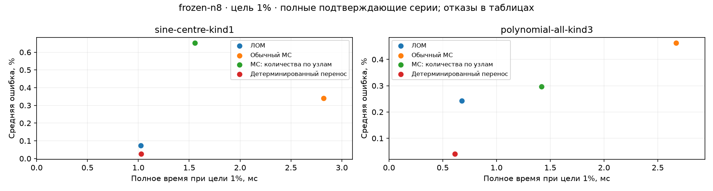
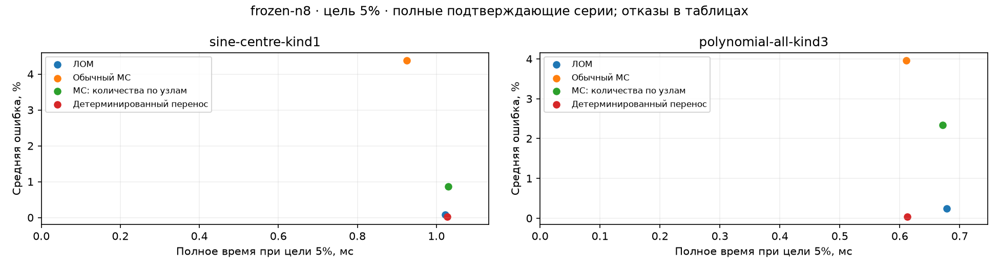
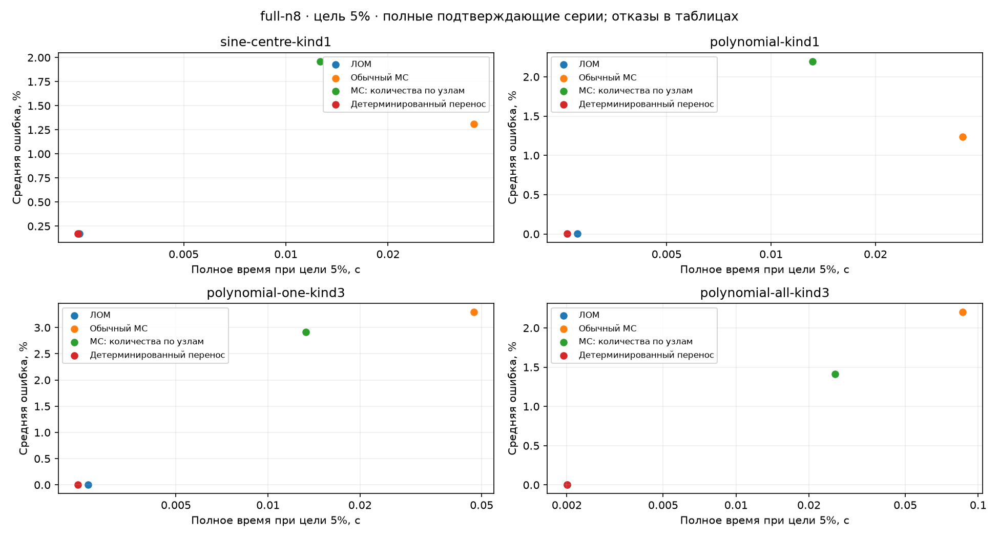
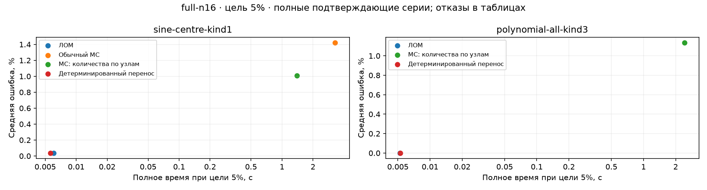

# Перенос количеств частиц и весов: сравнение с обычным MC и ЛОМ

В ограниченной серии перенос случайных целых количеств (`mc_counts`) ускорил
полную нелинейную историю при подтверждённой цели 5%: в **2,71–3,55 раза на n=8**
и в **2,36 раза для синуса на n=16** относительно обычного MC при одинаковом N.
Детерминированный перенос (`mass_transport`) дал время, близкое к ЛОМ;
оба детерминированных метода на этих задачах существенно быстрее MC.
Для одной замороженной системы результат зависит от цели: при 1% и одинаковом
N=16384 перенос количеств быстрее MC в 1,81–1,88 раза, а при 5% подбор выбрал
большее N для переноса и его полное время оказалось хуже.

Это сравнение двух новых алгоритмов. Прежний `mc_grouped` обрабатывает
отдельные траектории пакетами; его [исторические результаты](results/heat3d-final/README.md)
и [отрицательный стационарный результат](results/grouped-mc3d/README.md)
не заменены и не переименованы.

## Версия, план и смысл измерений

Измерения выполнены 26 ноября 2026 года на чистом commit
[`ec12d1ebececffea430e81863f6318ea7b77c3b9`](https://github.com/Nok1o/pde/commit/ec12d1ebececffea430e81863f6318ea7b77c3b9),
[PR #58](https://github.com/Nok1o/pde/pull/58), после независимого численного
ревью и 1395 успешных тестов общей версии. Все 32 задания выполнились
последовательно в свежих процессах, Python 3.13.14, macOS 26.7.3 arm64,
NumPy 2.5.4, SciPy 1.18.1, Numba 0.68.0; BLAS/Numba — один поток.
В согласованное окно другие исполнители не запускали вычисления или тесты.

[План](heat3d-transport-plan.md), кандидаты, ограничения и правило расширения
зафиксированы до первой попытки. Файлы исходников и планы неизменны во всех
трёх манифестах `source_before == source_after`; dirty=false.
После окна изменены только отчёт и построение графиков по сохранённым данным.
Проверки и результаты ревью кода относятся к измеренному commit; сохранение
данных дополнительно проверено побайтово и каталогом SHA256.

Два опыта рассматриваются раздельно:

- **Замороженная система:** один A u=b, n=8, dt=0,02, один стартовый узел.
  Синус — центр, все грани с условиями 1 рода; полином — (0,25; 0,5; 0,75),
  все грани с условиями 3 рода. Предыдущее поле — начальное условие,
  приближение для коэффициентов — `previous + 0.1*(x + 2*y + 3*z)`.
  Эталон — отдельное разреженное прямое решение этой же сеточной системы.
- **Полная история:** dt=0,002, T=0,004, два физических слоя, неявный Эйлер
  и Пикар. Четыре случая n=8 и два крайних случая n=16; эталон — аналитическое
  изготовленное решение в конечный момент. Все необходимые поля предыдущих
  слоёв и независимые проверки остановки MC вычисляются самим методом.

Везде α=γ=0,5, σ=1, β=1; k(u)=1+αu², c(u)=1+γu², источник F−σu³.
Решателям не передаются эталонные ответы. В frozen `mass_transport` переносит
единичную массу по узлам для заданного старта. В полной истории используется
эквивалентная итерация Якоби для всех стартов одновременно с начальным
приближением, как у ЛОМ. Это детерминированный алгоритм; у него нет N,
случайного seed или стандартной ошибки MC. Успех frozen не подтверждает
аналитическую точность полной истории.

Для каждой цели 1/5/10% общий `study_protocol` выбирает бюджет по R=5
предварительным запускам с запасом 0,8 цели, затем выполняет независимую
финальную R=5 серию. Финальная неудача не вызывает новый подбор.
Кандидаты N одинаковы у MC и MC количеств: 256/1024/4096/16384 для frozen,
256/1024/4096 для полной истории. Для ЛОМ и переноса весов заданы τ=10⁻³/10⁻⁶;
во всех подтверждённых детерминированных строках выбран 10⁻³. Внутренний смысл
τ различается: линейная невязка ЛОМ, критерий хвоста frozen-массы и критерии
полного детерминированного решателя; сравнение задаёт **общая внешняя цель**.
У детерминированных методов R=5 измеряет разброс времени свежих запусков,
а не статистическую неопределённость решения.

Ошибка — `100 * mean_runs(norm_Q(u_run-reference)/norm_Q(reference))`,
здесь Q — одна точка. Это средняя ошибка отдельных полных запусков,
не ошибка усреднённого ответа и не RMSE. Цели относятся к среднему R=5,
не гарантируют порог каждого отдельного запуска или всей пространственной сетки.
Полное время включает сборку, подготовку, все слои, итерации и независимые
проверки MC. JIT-прогрев, внешние эталоны и экспорт вынесены за этот таймер
и отдельно записаны. Подготовка входит в полное время и не прибавляется повторно.

## Объём и все попытки

Уникальные попытки считаются по `trials`, а не суммой строк целей:
одна выбранная серия может подтверждать сразу несколько целей.

| Этап | Попыток | Полных | Лимит Пикара | Лимит времени | Целей подтверждено | Все попытки, с |
| --- | --- | --- | --- | --- | --- | --- |
| frozen-n8 | 170 | 170 | 0 | 0 | 24/24 | 0.203386 |
| full-n8 | 270 | 244 | 26 | 0 | 39/48 | 10.454845 |
| full-n16 | 115 | 71 | 38 | 6 | 18/24 | 152.040385 |

Итого **555 попыток: 485 полных, 64 отказа по внешним итерациям,
6 по времени; 81/96 целей подтверждено**. Полная история отдельно — 57/72 целей.
Суммарное время решателей всех попыток — **162,698616 с**, включая подбор
и неудачи; это не сумма только успешных финальных запусков.

Перед n=16 записано [решение по стоимости](results/heat3d-transport/cost-decision.json):
все попытки двух этапов n=8 стоили **10,658231 с ≤ 120 с**. Решение принято
в 15:19:50 UTC до старта n=16. Последующий n=16 стоил 152,040385 с:
порог 120 с разрешал расширение, а не ограничивал продолжительность
уже разрешённого большого этапа. Новых сценариев или повторных серий по
наблюдаемому выигрышу не добавляли. Все исходные журналы, включая отказы,
сохранены; аварий worker и перезапусков не было.

## Одна замороженная система

Прямые эталоны дали относительную невязку 2,71·10⁻¹⁵ для синуса и
2,35·10⁻¹⁵ для полинома, существенно ниже допустимых 10⁻¹⁰.
Хэши массивов оператора совпадают у эталона и каждой попытки метода.
Вычисления эталона выполнены отдельными процессами и не входят ни во время,
ни в RSS изучаемых методов. Значения, остатки и стоимость эталонов находятся
в `frozen-n8/*--reference.json`.

Все 24 цели подтверждены. Ниже цель **1%**, R=5. Время — среднее ± выборочное
стандартное отклонение, мс; подготовка и построение также усреднены по пяти
попыткам. Подготовка включает повторное построение системы.
N относится только к MC; τ — допуск детерминированного метода.

| Сценарий | Метод | N / τ | Ошибка, % | Полное время, мс | Подготовка, мс | Построение, мс |
| --- | --- | --- | --- | --- | --- | --- |
| Синус, 1 род | ЛОМ | τ=0.001 | 0.0736 | 1.022 ± 0.056 | 0.816 | 0.816 |
| Синус, 1 род | MC | 16384 | 0.3411 | 2.822 ± 0.033 | 0.855 | 0.841 |
| Синус, 1 род | MC количеств | 16384 | 0.6525 | 1.555 ± 0.201 | 0.888 | 0.873 |
| Синус, 1 род | Перенос весов | τ=0.001 | 0.0270 | 1.027 ± 0.084 | 0.950 | 0.924 |
| Полином, все 3 рода | ЛОМ | τ=0.001 | 0.2424 | 0.678 ± 0.027 | 0.452 | 0.452 |
| Полином, все 3 рода | MC | 16384 | 0.4629 | 2.670 ± 0.049 | 0.510 | 0.496 |
| Полином, все 3 рода | MC количеств | 16384 | 0.2965 | 1.418 ± 0.087 | 0.495 | 0.482 |
| Полином, все 3 рода | Перенос весов | τ=0.001 | 0.0411 | 0.612 ± 0.027 | 0.494 | 0.470 |

При одинаковом N=16384 полное время MC/counts составляет 1,815 для синуса
и 1,883 для полинома. Это измеренный выигрыш данного сочетания точки,
оператора и N; оценка полной стоимости учитывает повторную подготовку.
Сам перенос весов здесь быстрее MC, но не даёт общего преимущества над ЛОМ:
синус 1,027 против 1,022 мс, полином 0,612 против 0,678 мс. R=5 и малые
времена не позволяют переносить эти небольшие различия на другие задачи.



При менее строгих целях итог меняется; приведены оба MC-варианта.

| Сценарий | Цель, % | Метод | N | Ошибка, % | Полное время, мс |
| --- | --- | --- | --- | --- | --- |
| Синус, 1 род | 5.0 | MC | 256 | 4.3797 | 0.925 |
| Синус, 1 род | 10.0 | MC | 256 | 4.3797 | 0.925 |
| Синус, 1 род | 5.0 | MC количеств | 1024 | 0.8595 | 1.030 |
| Синус, 1 род | 10.0 | MC количеств | 256 | 4.0011 | 0.918 |
| Полином, все 3 рода | 5.0 | MC | 256 | 3.9621 | 0.611 |
| Полином, все 3 рода | 10.0 | MC | 256 | 3.9621 | 0.611 |
| Полином, все 3 рода | 5.0 | MC количеств | 1024 | 2.3419 | 0.671 |
| Полином, все 3 рода | 10.0 | MC количеств | 256 | 6.0499 | 0.593 |

Для 5% пилот выбрал N=256 у обычного MC и 1024 у переноса количеств.
Поэтому перенос в обоих случаях медленнее: 1,030 против 0,925 мс и
0,671 против 0,611 мс. Различие выбранных N в конечной R=5 выборке
**не доказывает изменения дисперсии** и не позволяет приписать отношение
времени одной только экономии узловых операций. При 10% одинаковое N=256
даёт близкие времена; надёжный общий выигрыш из этой малой серии не следует.
После этих результатов дополнительные серии фиксированного N не запускались.



В финальных R=5 сериях цели 1% у counts на синусе обработано 20 714 узлов
при 519 003 виртуальных перемещениях, у полинома — 39 090 и 603 746.
Это фактическая агрегация частиц по узлам. Число операций генератора
биномиальных количеств и стоимость обновления узла не постоянны; отношение
этих счётчиков не является коэффициентом ускорения.
Граница хвоста frozen-массы — 0,001633 и 0,002192 в абсолютных единицах;
она не является процентной аналитической ошибкой или доверительным интервалом.

## Полная нелинейная история

Таблица показывает цель **5%**; все перечисленные завершённые серии R=5.
Подготовка указана в среднем на попытку, включая затраты неполных попыток.
Время включает всю историю до T, а не один внутренний замороженный solve.
Неподтверждённый MC на n=16 сохранён как отказ, без фиктивного времени цели.
Все 1/5/10% и причины отказов есть в
[полной таблице](results/heat3d-transport/complete_nonlinear_history.md).

| n | Сценарий | Метод | N / τ | Ошибка, % | Полное время, мс | Подготовка, мс | Статус |
| --- | --- | --- | --- | --- | --- | --- | --- |
| 8 | Синус, 1 род | ЛОМ | τ=0.001 | 0.1697 | 2.462 ± 0.165 | 1.924 | confirmed |
| 8 | Синус, 1 род | MC | 1024 | 1.3121 | 35.794 ± 0.511 | 3.090 | confirmed |
| 8 | Синус, 1 род | MC количеств | 1024 | 1.9611 | 12.643 ± 0.361 | 3.150 | confirmed |
| 8 | Синус, 1 род | Перенос весов | τ=0.001 | 0.1697 | 2.441 ± 0.167 | 2.110 | confirmed |
| 8 | Полином, 1 род | ЛОМ | τ=0.001 | 0.0019 | 2.764 ± 0.147 | 2.258 | confirmed |
| 8 | Полином, 1 род | MC | 1024 | 1.2372 | 35.692 ± 0.221 | 3.085 | confirmed |
| 8 | Полином, 1 род | MC количеств | 1024 | 2.1977 | 13.171 ± 0.250 | 3.612 | confirmed |
| 8 | Полином, 1 род | Перенос весов | τ=0.001 | 0.0019 | 2.581 ± 0.224 | 2.231 | confirmed |
| 8 | Полином, x0 3 рода | ЛОМ | τ=0.001 | 0.0020 | 2.577 ± 0.162 | 2.007 | confirmed |
| 8 | Полином, x0 3 рода | MC | 1024 | 3.2940 | 47.134 ± 0.810 | 3.788 | confirmed |
| 8 | Полином, x0 3 рода | MC количеств | 1024 | 2.9128 | 13.275 ± 0.283 | 2.935 | confirmed |
| 8 | Полином, x0 3 рода | Перенос весов | τ=0.001 | 0.0020 | 2.391 ± 0.073 | 2.075 | confirmed |
| 8 | Полином, все 3 рода | ЛОМ | τ=0.001 | 0.0017 | 2.003 ± 0.048 | 1.471 | confirmed |
| 8 | Полином, все 3 рода | MC | 1024 | 2.2011 | 86.396 ± 2.877 | 2.681 | confirmed |
| 8 | Полином, все 3 рода | MC количеств | 1024 | 1.4154 | 25.657 ± 0.189 | 2.375 | confirmed |
| 8 | Полином, все 3 рода | Перенос весов | τ=0.001 | 0.0017 | 2.009 ± 0.057 | 1.615 | confirmed |
| 16 | Синус, 1 род | ЛОМ | τ=0.001 | 0.0379 | 6.033 ± 0.080 | 3.109 | confirmed |
| 16 | Синус, 1 род | MC | 4096 | 1.4217 | 3286.750 ± 82.551 | 5.559 | confirmed |
| 16 | Синус, 1 род | MC количеств | 4096 | 1.0101 | 1392.547 ± 102.578 | 5.865 | confirmed |
| 16 | Синус, 1 род | Перенос весов | τ=0.001 | 0.0379 | 5.633 ± 0.056 | 3.532 | confirmed |
| 16 | Полином, все 3 рода | ЛОМ | τ=0.001 | 0.0009 | 5.229 ± 0.188 | 2.308 | confirmed |
| 16 | Полином, все 3 рода | MC | 4096 | — | — | 4.377 | pilot_incomplete |
| 16 | Полином, все 3 рода | MC количеств | 4096 | 1.1351 | 2425.745 ± 127.567 | 4.647 | confirmed |
| 16 | Полином, все 3 рода | Перенос весов | τ=0.001 | 0.0009 | 5.269 ± 0.089 | 2.699 | confirmed |

При 5% на n=8 в каждой паре MC/counts выбрано одинаковое N=1024.
Отношение полного времени обычного MC к counts: **2,831 / 2,710 / 3,551 / 3,367**
для синуса, полинома с условиями 1 рода, одной и всеми гранями 3 рода.
На n=16 у синуса одинаковое N=4096 и отношение **2,360**.
У полинома n=16 обычный MC не завершил предварительную R=5 серию N=4096
из-за времени; counts подтвердил 5% за 2,426 с. Здесь нет корректного
коэффициента ускорения по времени достижения цели двух методов.

ЛОМ и перенос весов подтвердили **все 18/18 целей полной истории каждый**.
Их ошибки практически совпадают, времена составляют 2,0–2,8 мс на n=8
и 5,2–6,0 мс на n=16. На синусе n=16 перенос весов быстрее в этой серии,
на полиноме немного медленнее; общего превосходства над ЛОМ данные не доказывают.
На проверенных небольших плотных сетках оба детерминированных метода
гораздо дешевле MC, в том числе нового переноса количеств.





Графики показывают только подтверждённые цели. Отсутствующая точка обычного MC
у полинома n=16 — отказ, а не нулевое время/ошибка. Временная ось full
логарифмическая, frozen — линейная от нуля в миллисекундах.

### Пути и реальная узловая работа

Ниже суммы за выбранную финальную R=5 серию counts при 5%.
N — число частиц **одной** внутренней оценки; полная история запускает оценки
во многих узлах, на итерациях и для независимой остановки, поэтому фактическое
число путей намного больше 5N. Эти суммы повторяются в нескольких строках
целей, если финальная серия переиспользуется.

| n | Сценарий | N | Начато путей | Виртуальные перемещения | Обновления узлов | Непустые потоки |
| --- | --- | --- | --- | --- | --- | --- |
| 8 | Синус, 1 род | 1024 | 7024640 | 4278093 | 476966 | 712642 |
| 8 | Полином, 1 род | 1024 | 7024640 | 4238805 | 471807 | 703529 |
| 8 | Полином, x0 3 рода | 1024 | 8028160 | 5074267 | 567460 | 850381 |
| 8 | Полином, все 3 рода | 1024 | 14929920 | 11381702 | 1303246 | 1999607 |
| 16 | Синус, 1 род | 4096 | 276480000 | 698377503 | 71232410 | 135520217 |
| 16 | Полином, все 3 рода | 4096 | 402472960 | 1226506255 | 128936688 | 248006713 |

У MC/counts `transitions` считает пространственные перемещения всех
представленных частиц. Для counts это виртуальная работа индивидуальных
траекторий, а `node_updates` и `edge_transfers` считают реальные узлы и
непустые исходящие потоки групп. Сохранение вероятностного закона
обосновывается алгоритмом и тестами ядра; R=5 не доказывает равенство законов.

У полного детерминированного переноса `node_updates` — обновления свободных
строк, `transport_sweeps` — полные итерации поля, а `edge_transfers` —
обработанные ненулевые коэффициенты переходов, в том числе при нулевом
значении текущего приближения. У frozen-массы это переносы непустых весов.
Эти единицы работы не отождествляются. Нулевые новые счётчики обычного MC
в исходном API означают неприменимость; в сводке стоят прочерки.

### Неподтверждённые цели и неполные истории

Все 15 неподтверждённых строк относятся к полной истории; ни одна не
выдана за решение в T. Ошибка ниже относится только к полной выбранной
предварительной/финальной серии; для неполной серии она отсутствует.
Затраты включают и неудачные попытки выбранной R=5 серии.

| n | Сценарий | Метод | Цель, % | Фаза | Полных / 5 | Ошибка, % | Затраты R=5, с | Статус |
| --- | --- | --- | --- | --- | --- | --- | --- | --- |
| 8 | Синус, 1 род | MC | 1.0 | final | 5 | 1.7614 | 0.670 | validation_failed |
| 8 | Синус, 1 род | MC количеств | 1.0 | pilot | 5 | 1.8163 | 0.109 | not_reached |
| 8 | Полином, 1 род | MC | 1.0 | pilot | 5 | 0.9295 | 0.655 | not_reached |
| 8 | Полином, 1 род | MC | 10.0 | final | 4 | — | 0.121 | validation_incomplete |
| 8 | Полином, 1 род | MC количеств | 1.0 | pilot | 5 | 0.9307 | 0.105 | not_reached |
| 8 | Полином, x0 3 рода | MC | 10.0 | final | 3 | — | 0.202 | validation_incomplete |
| 8 | Полином, x0 3 рода | MC количеств | 1.0 | pilot | 5 | 0.8347 | 0.122 | not_reached |
| 8 | Полином, x0 3 рода | MC количеств | 10.0 | final | 4 | — | 0.083 | validation_incomplete |
| 8 | Полином, все 3 рода | MC | 1.0 | pilot | 5 | 1.6390 | 1.634 | not_reached |
| 16 | Синус, 1 род | MC | 1.0 | pilot | 5 | 1.4203 | 16.259 | not_reached |
| 16 | Синус, 1 род | MC количеств | 1.0 | pilot | 5 | 0.9094 | 6.544 | not_reached |
| 16 | Полином, все 3 рода | MC | 1.0 | pilot | 0 | — | 27.194 | pilot_incomplete |
| 16 | Полином, все 3 рода | MC | 5.0 | pilot | 0 | — | 27.194 | pilot_incomplete |
| 16 | Полином, все 3 рода | MC | 10.0 | pilot | 0 | — | 27.194 | pilot_incomplete |
| 16 | Полином, все 3 рода | MC количеств | 1.0 | pilot | 5 | 0.8153 | 12.070 | not_reached |

`not_reached` — не достигнут предварительный запас 0,8 цели;
`validation_failed` — полная финальная серия не подтвердила цель;
`validation_incomplete` / `pilot_incomplete` — соответствующая серия содержит
неполные истории. В последнем случае частичная история не даёт конечного ответа.

На n=8 обычный MC для синуса выбрал N=4096 на 1%, но финальная средняя ошибка
оказалась 1,7614%; это единственный `validation_failed`. У ряда других строк
ошибка пилота меньше 1%, но больше 0,8%, поэтому 1% закономерно не подтверждён.
Для полинома n=16 counts получил 0,8153% в пилоте — также вне запаса 0,8%.

Цель 10% может остаться неподтверждённой при подтверждённой 5%: для неё пилот
выбрал дешевле N=256, а финальная серия отказала. Например, полином с условиями
1 рода у MC завершил лишь 4/5 историй; с одной гранью 3 рода — 3/5 у MC
и 4/5 у counts. Протокол не заменяет провал постфактум другой финальной серией.

В сумме отказов n=8: 26 `outer_limit` (24 на первом слое, 2 на втором).
На n=16: 38 `outer_limit` на первом слое и 6 `time_limit` на втором.
Предел восьми итераций Пикара и мягкий предел 5 с заданы до измерений.
Максимальная попытка заняла 5,519 с: начатая внутренняя оценка может пересечь
мягкий лимит. Это сохранённый отказ, не подтверждение точности.

## Подготовка и память

Сборка и подготовка включены в таблицы времени. На frozen 1% они занимают
примерно 0,49–0,89 мс у MC/counts, то есть существенную часть полного времени.
На полной n=16 5% подготовка MC/counts порядка 4,6–5,9 мс против секунд
самого решения; ускорение нельзя объяснить исключением подготовки из таймера.
У неподтверждённой строки n=16 время подготовки — затраченная работа,
а не подготовка успешного решения.

Таблица памяти: диапазон по сценариям **подтверждённых целей 5%**.
Численные буферы — оценка API выбранной серии. RSS — пик свежего процесса
со всеми попытками, импортами и JIT, а не чистая память одного решения.
1 МиБ = 2²⁰ байт. В частности, близкий RSS малых задач скрывает различие
размеров численных буферов.

| Этап | Метод | Численные буферы, МиБ | RSS процесса, МиБ |
| --- | --- | --- | --- |
| frozen-n8 | ЛОМ | неизвестно | 142.422–142.516 |
| frozen-n8 | MC | 0.123 | 142.797–142.922 |
| frozen-n8 | MC количеств | 0.168 | 144.094–145.531 |
| frozen-n8 | Перенос весов | 0.168 | 144.141–144.281 |
| full-n8 | ЛОМ | 0.225 | 142.688–144.297 |
| full-n8 | MC | 0.509 | 143.172–144.062 |
| full-n8 | MC количеств | 0.554 | 144.656–145.125 |
| full-n8 | Перенос весов | 0.225 | 144.219–146.109 |
| full-n16 | ЛОМ | 1.501 | 143.797–144.031 |
| full-n16 | MC | 3.414 | 147.797 |
| full-n16 | MC количеств | 3.714 | 148.953–149.531 |
| full-n16 | Перенос весов | 1.501 | 145.422–145.562 |

У frozen ЛОМ публичный API не оценивает workspace: это неизвестная
величина, а не ноль. У counts дополнительные массивы количеств увеличивают
численные буферы относительно обычного MC; новый перенос не представлен
как универсальная экономия памяти. Все строки, включая отказы и более
строгие бюджеты, доступны в CSV, без отбора только успешных случаев.

## Где методы полезны и границы вывода

- **ЛОМ:** самый простой практический ориентир для проверенных небольших
  плотных сеток и полной истории; все цели подтверждены, стоимость мала.
- **Обычный MC:** сохраняется как базовый случайный метод. Для одной
  frozen-точки и умеренной точности он может быть дешевле агрегирования;
  на полной истории поля и независимые проверки увеличивают стоимость.
- **MC количеств:** полезен, когда много частиц проходят через одни узлы.
  Измеренный выигрыш есть при одинаковом большом N в frozen и при 5% полной
  истории. Он не отменяет отказы Пикара, ограничения времени или необходимость
  независимой финальной серии; меньшей дисперсии по этим данным не заявляем.
- **Детерминированный перенос весов:** корректный отдельный способ суммировать
  распределение в frozen; в полной задаче — итерация Якоби для всех стартов.
  На этих опытах качество и время близки к ЛОМ. Его успешность не превращает
  его в статистический MC и не доказывает превосходство над ЛОМ.

Серия ограничена двумя слоями, α=γ=0,5, σ=1, синусом/полиномом, одной
контрольной точкой и n=8/16. Длинные истории, иные коэффициенты, большие сетки
и произвольные источники не исследованы. Фиксированный порядок методов,
одна машина, R=5 и отсутствие доверительных интервалов ограничивают выводы
о малых различиях времени. Предварительный выбор N по эталонной ошибке —
исследовательская калибровка, а не доступный без эталона пользовательский
критерий остановки. Общая цель точности не означает тождественную фактическую
ошибку двух методов. Новые серии ради усиления положительного результата
после просмотра данных не запускались.

## Данные и воспроизведение

- [Все цели 1/5/10% frozen](results/heat3d-transport/one_frozen_system.md)
  и [полной истории](results/heat3d-transport/complete_nonlinear_history.md):
  ошибка, время, память, фактические пути, статусы и причины.
- [targets.csv](results/heat3d-transport/targets.csv): выбранные серии,
  фаза, бюджет, подготовка, разброс времени и счётчики; строки целей могут
  ссылаться на одну серию и не должны суммироваться как независимые затраты.
- [trials.csv](results/heat3d-transport/trials.csv): все 555 уникальных попыток.
  [totals.json](results/heat3d-transport/totals.json) — контрольные суммы счётчиков,
  [stages.csv](results/heat3d-transport/stages.csv) — стоимость этапов.
- [frozen-n8](results/heat3d-transport/frozen-n8),
  [full-n8](results/heat3d-transport/full-n8),
  [full-n16](results/heat3d-transport/full-n16): неизменённые исходные JSON/CSV,
  манифесты, планы и журналы. В frozen также отдельные direct-эталоны и
  started/finished журнал каждой попытки.
- [raw-sha256.json](results/heat3d-transport/raw-sha256.json): SHA256 исходных
  файлов, включая решение по стоимости. Производные таблицы/графики не
  подменяют исходные экспорты.

Для повторных численных опытов нужен отдельный чистый checkout измеренного
commit, закреплённое окружение Python 3.13.14 и свободное вычислительное окно.
Выходной каталог должен быть новым. Драйверы задают один поток всем worker.
Использовать команды из [плана](heat3d-transport-plan.md) в последовательности
frozen-n8 → full-n8 → запись `--gate` → full-n16 только при разрешающем решении.
Повторения задаются планами и seed_rule общего протокола; изменение версии
или seed является новым опытом. Результаты старой версии не перезаписываются.

Для воспроизведения только таблиц и графиков по опубликованным данным
на итоговой версии PR (решатели не запускаются):

```sh
.venv/bin/python -m benchmarks.heat3d_transport_report \
  --root benchmarks/results/heat3d-transport
```

Сборщик отклоняет неполные/изменённые манифесты, разные commit этапов,
несовпадение записанного решения по стоимости и ложное подтверждение
неполной финальной серии. Текстовые выводы этого отчёта сопоставлены
с исходными сериями; независимая проверка пакета данных проводится владельцем PR.
