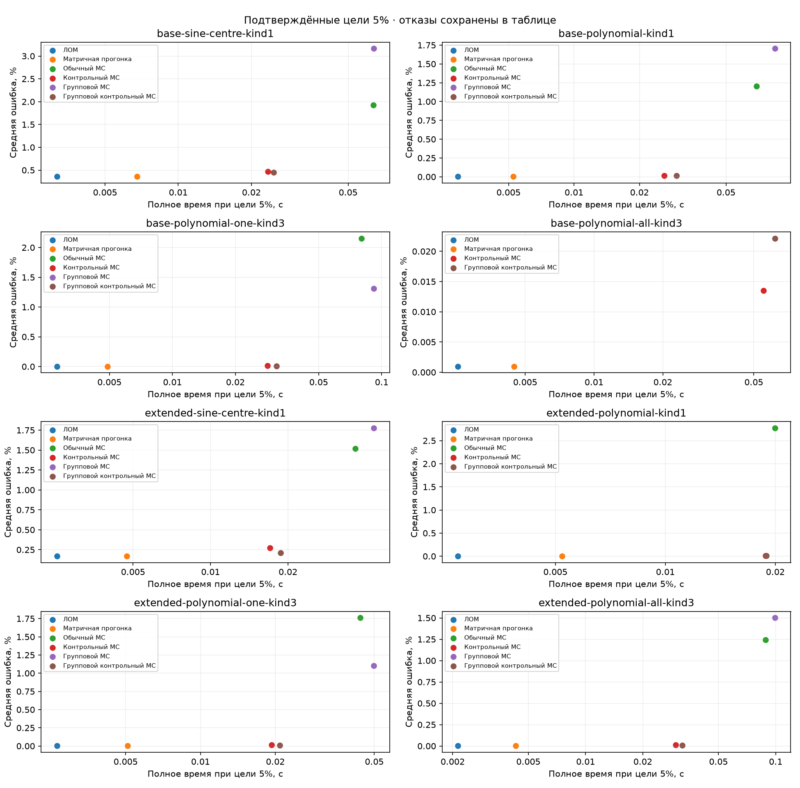
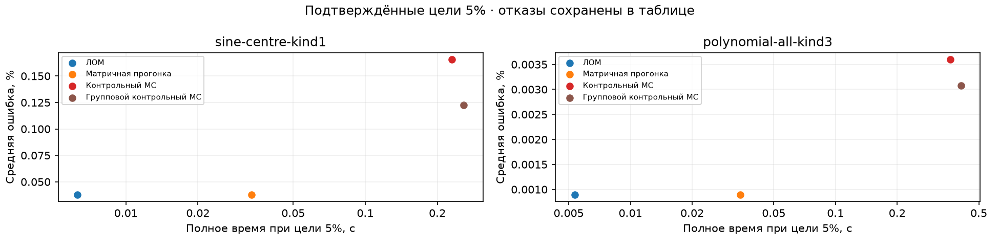
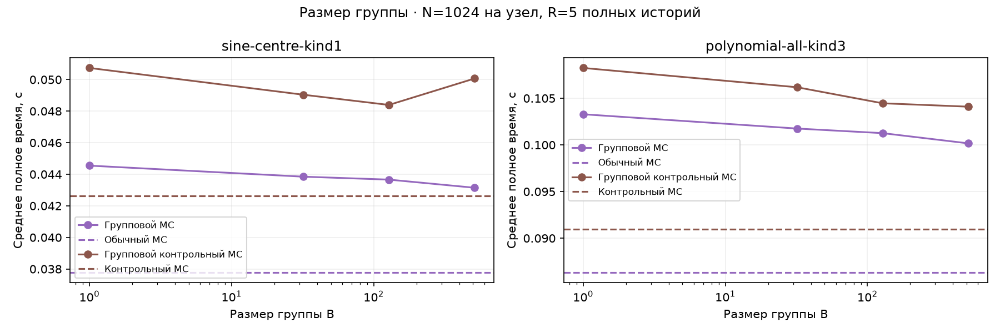
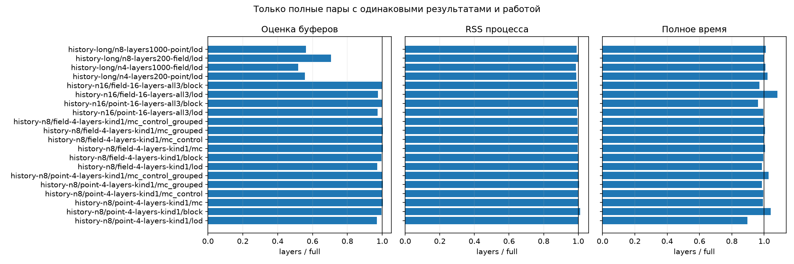
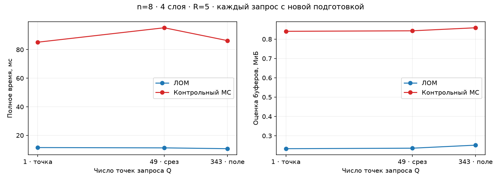
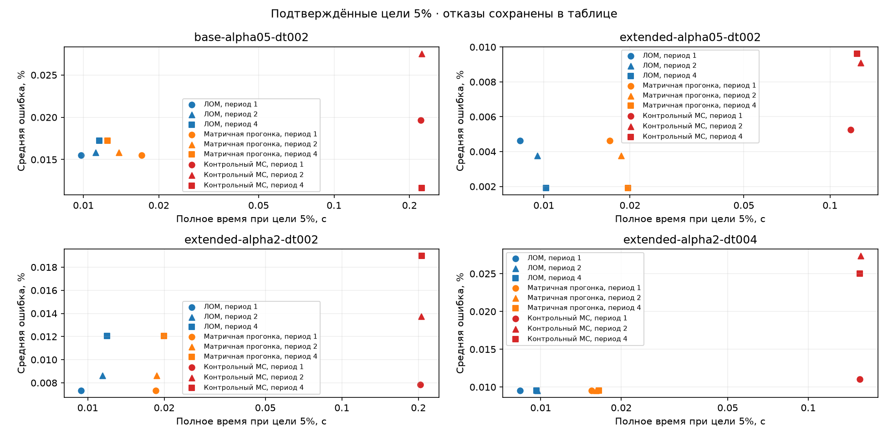
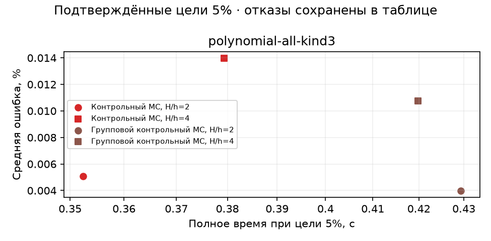

# Итоговое исследование #31: шесть методов и проверка оптимизаций

В основной серии подтверждены **146 из 180 целей 1/5/10%**. ЛОМ имеет
наименьшее среднее полное время во всех 30 сочетаниях задачи и цели.
Оба контрольных MC подтвердили все основные цели; обычное MC-семейство
с заданными бюджетами не завершило серии n=16. Группировка не дала выигрыша.
Сокращение истории заметно уменьшает оценку памяти длинных расчётов ЛОМ,
а редкое обновление проводимости полезно только в одном проверенном классе:
матричная прогонка базовой модели с постоянными теплоёмкостью и реакцией.

Сохранены **188 заданий, 1510 попыток**: 1315 завершены, 154 остановлены
по лимиту Пикара, 41 — по времени. Ни одна попытка не исключена и не заменена
повтором. Из 300 целей всего пакета подтверждены 266; остальные 34 сохранены
с причинами. Дополнительные цели проводимости/грубой сетки не включены
в число 146/180 основной серии. Фиксированные серии сами по себе не являются
независимым подтверждением целей 1/5/10%.

- [Все цели: ошибка, полное время, память, пути и отказы](targets.md), [CSV](targets.csv).
- [Фиксированные бюджеты](fixed.md), [CSV](fixed.csv).
- [Пары full/layers](history-pairs.md), [CSV](history-pairs.csv).
- [Все 1510 попыток](trials.csv), [итоги и причины](totals.json), [этапы](stages.csv).
- [План до измерений](../../heat3d-final-plan.md) и [приёмка UI/CLI/экспорта](../../heat3d-final-acceptance.md).

## Версия, постановка и стоимость

Измерено 26 ноября 2026 года (Москва) на чистом коммите
[`0305ca8c48cf7c0ef4357e7ef0e1adef71e01388`](https://github.com/Nok1o/pde/commit/0305ca8c48cf7c0ef4357e7ef0e1adef71e01388),
поверх общего main `245155a3`. Все десять манифестов подтверждают одинаковые
исходники до и после запуска. Python 3.13.14, NumPy 2.5.4, SciPy 1.18.1,
Numba 0.68.0, macOS 26.7.2 arm64. Окружение закреплено в проекте.
Процессы выполнялись последовательно, BLAS/Numba — в один поток;
с другим исполнителем согласовано отсутствие параллельных тестов/расчётов.
Порядок методов фиксирован; случайные колебания времени не удалялись.

Модель: c(u)=1+γu², k(u)=1+αu², источник F−σu³. Базовый вариант γ=σ=0,
расширенный γ=0,5, σ=1. Изготовленные синус и полином, куб, физическое время,
неявный Эйлер и Пикар. ЛОМ — направленный решатель общей неявной системы,
а не отдельная схема с необъявленной ошибкой расщепления.
[Постановка](../../../docs/heat3d-contract.md), [материальная модель](../../../docs/heat3d-materials.md),
[условия 1/3 рода](../../../docs/heat3d-boundaries.md).
Аналитическое поле используется только для ошибки, прошлое поле вычисляет решатель.
Ньютон — отдельная функциональная проверка малых задач, не источник ответа MC.

Основная таблица: четыре случая пилота на n=8 для каждой модели; два крайних
случая расширенной модели на n=16. Синус — центр (0,5; 0,5; 0,5), полином —
(0,25; 0,5; 0,75). α=0,5, dt=0,002, T=0,004. У полинома сравниваются все
грани 1 рода, только x0 3 рода и все грани 3 рода, β=1. H/h=2, B=128
зафиксированы до измерений. Делимость n на coarse_n не требуется API:
между сетками применяется интерполяция.

Для каждой цели предварительная серия R=5 выбирает первый бюджет с ошибкой
не более 0,8 цели; новая независимая серия R=5 проверяет выбранный бюджет.
После её результата бюджет не перенастраивается. Кандидаты прогонок —
10⁻³/10⁻⁶, MC — 256/1024 пути на свободный узел за одну оценку поля.
Приёмка MC использует невязку/изменение 0,2/0,1 и независимые случайные пути.
Общие пределы: восемь итераций Пикара на слой, 20 000 внутренних итераций,
5 с на историю, 100 000 переходов пути, 256 МиБ оценки рабочих буферов;
полные пределы путей/переходов сохранены в каждом плане.

Ошибка — `100/R × Σ ||u_run−u*||₂ / ||u*||₂` на фиксированном Q.
Для одной точки это средняя абсолютная относительная ошибка отдельного
полного запуска. Это не RMSE и не ошибка среднего решения. Невязки
сохранены отдельно. При нулевом эталоне проценты неприменимы; функциональные
проверки этого случая описаны [отдельно](../../../docs/zero-reference-studies.md).
Все измеренные здесь эталоны имеют ненулевую норму.

Таймер решателя включает подготовку, грубую сетку, все слои, итерации и
проверки остановки. Подготовка — часть полного времени, её не прибавляют
повторно. Прогрев/JIT, аналитический эталон и экспорт исключены;
`warmup_seconds` и `analytic_reference_seconds` сохранены в исходных JSON.
Вызов исследования с подготовкой/прогревом занял суммарно 592,763 с;
это не время запуска интерпретаторов, исходных импортов или экспорта.
Время решателей всех попыток — **562,306 с**: подбор 110,095 с,
независимые финальные серии 33,782 с, фиксированные серии 418,428 с.
Предел 5 с мягкий: самая долгая попытка заняла 5,386 с.

`workspace_bytes` — оценка рабочего набора. Измеренный RSS относится к
отдельному процессу задания, включая библиотеки, JIT и все повторы до экспорта,
а не к одному решению. `process_seconds` в сводке — время вызова исследования.
Пути — фактически начатые и завершённые за указанную серию, отдельно;
`transitions` в этом временном режиме считает пространственные перемещения.
У детерминированных методов пути и seed неприменимы; нулевые счётчики не
означают наличие случайной выборки. Одни финальные повторы могут обслуживать
несколько целей: затраты строк целей нельзя суммировать, для этого есть trials.csv.

## Основное сравнение

Ниже среднее полное время подтверждённой цели 5%, мс. Все ошибки, цели 1/10%,
разброс, подготовка и фактическая работа — в [основной таблице](targets.md).
«—» означает отсутствие полной подтверждающей серии, а не нулевую стоимость.

| Модель, сетка, случай | ЛОМ | Матричная | MC | Контрольный MC | Групповой MC | Групповой контрольный MC |
|---|---:|---:|---:|---:|---:|---:|
| Базовая, n=8, синус, 1 род | 3,17 | 6,77 | 63,49 | 23,43 | 63,83 | 24,66 |
| Базовая, n=8, полином, 1 род | 2,93 | 5,26 | 69,07 | 25,94 | 83,91 | 29,59 |
| Базовая, n=8, полином, x0 3 рода | 2,81 | 4,89 | 80,01 | 28,47 | 91,80 | 31,51 |
| Базовая, n=8, полином, все 3 рода | 2,54 | 4,48 | — | 55,10 | — | 61,86 |
| Расширенная, n=8, синус, 1 род | 2,53 | 4,73 | 36,54 | 16,99 | 43,14 | 18,75 |
| Расширенная, n=8, полином, 1 род | 2,71 | 5,22 | 19,95 | 18,81 | — | 18,88 |
| Расширенная, n=8, полином, x0 3 рода | 2,65 | 5,09 | 43,81 | 19,32 | 49,81 | 20,85 |
| Расширенная, n=8, полином, все 3 рода | 2,13 | 4,29 | 88,53 | 29,81 | 99,08 | 32,27 |
| Расширенная, n=16, синус, 1 род | 6,28 | 33,54 | — | 230,14 | — | 258,24 |
| Расширенная, n=16, полином, все 3 рода | 5,34 | 34,41 | — | 362,36 | — | 409,18 |

ЛОМ, матричная прогонка и оба контрольных MC подтвердили по 30/30 целей.
Обычный MC — 14/30, групповой MC — 12/30. У обычного семейства семь целей
1% каждого варианта не получили запаса на подборе, девять целей каждого —
неполная предварительная серия. У группового MC на расширенном полиноме с
условиями 1 рода выбранный N=256 прошёл подбор, но в независимой серии
завершились только 3/5 повторов: цели 5% и 10% имеют `validation_incomplete`.
Бюджет после этого не увеличивался; 0,178 с этой серии учтены один раз.

Контрольные варианты достигли всех основных целей при N=256. На n=16
полином со всеми гранями 3 рода: контрольный MC дал 0,00360% ошибки за
362,36 мс, из них 10,02 мс подготовки. Это меньше стоимости обычного MC
при отказе, но коэффициент ускорения достижения цели для отказавшего метода
не определён. Оба контрольных варианта здесь значительно медленнее ЛОМ.

При смене границ на базовом полиноме время обычного MC для цели 5% выросло
с 69,07 до 80,01 мс (×1,158) при добавлении x0 3 рода. Отношение времени
ЛОМ/MC — 0,0424 и 0,0351. Для всех граней 3 рода цель обычного MC не
подтверждена. В расширенной модели эти отношения — 0,1356/0,0604/0,0241,
время MC — 19,95/43,81/88,53 мс. В первой точке выбран N=256, в остальных
N=1024: это полная стоимость достижения цели, не изолированная цена границы.
Меняется также число свободных узлов. Для изоляции подготовки см. профиль #32 ниже.





Графики показывают только подтверждённые цели 5%; все неподтверждённые строки
с затратами остаются в таблице. Смена γ/σ меняет саму задачу и вероятности MC,
поэтому уменьшение времени расширенного случая не называется ускорением кода.

## Размеры групп — отдельная серия

Расширенная модель, n=8, два исходных крайних сценария, N=1024, R=5,
B=1/32/128/512, независимый seed плана 31032. Завершены все 100 попыток.
B=1 побитово воспроизвёл значения, остановку и работу обычных вариантов
во всех четырёх парах сценарий/семейство. Проверка B=1 не обобщается на
другие размеры: там меняется порядок случайных выборок.

**Все 16 групповых вариантов медленнее соответствующего обычного семейства**:
отношение среднего полного времени 1,136–1,196. Число начатых/завершённых
путей совпало: 7 024 640 на пять историй синуса и 14 929 920 полинома.
Уменьшение дисперсии группировкой по R=5 не установлено. Основной B=128
не заменяется размером с наименьшим временем в этой контрольной серии.

При одинаковом N контрольное приближение тоже стоит дороже: 42,61 против
37,78 мс на синусе и 90,94 против 86,33 мс на полиноме. Его польза здесь —
меньшая ошибка (0,10070% против 1,50426% и 0,00618% против 1,87503%) и
возможность пройти основную серию точности с меньшим N. Это не равнозначно
безусловному уменьшению полного времени при любом бюджете.



## Длинная история, запрос и память — #33

На n=8 при четырёх слоях все шесть методов завершили все 120 попыток.
Для всех 12 пар точка/поле × метод варианты full/layers имеют одинаковые
значения, статус, итерации и пути. На n=16 при 16 слоях завершились только
прогонки: обычное MC-семейство исчерпало Пикар на первом слое, контрольное —
время после T=0,010–0,014 при требуемом T=0,032. Сохранены все 80 отказов;
усечённые поля не считаются решением в T.

Итого 20 полных пар имеют одинаковый результат и работу. Из восьми неполных
пар пять остановились одинаково, три — в разных местах из-за времени;
ни для одной неполной пары отношение времени/памяти полного решения не заявляется.
Seed обязателен в сопоставлении MC, неприменим для прогонок. Прочие поля
проверяются строго; неизвестный счётчик не заменяется совпадающим нулём.

| Длинный расчёт ЛОМ | Буферы full, МиБ | Буферы layers, МиБ | layers/full, время | layers/full, RSS |
|---|---:|---:|---:|---:|
| n=4, 200 слоёв, точка | 0,3923 | 0,2180 | 1,020 | 0,989 |
| n=4, 1000 слоёв, поле | 1,8098 | 0,9388 | 1,008 | 0,986 |
| n=8, 200 слоёв, поле | 0,5949 | 0,4205 | 0,997 | 1,003 |
| n=8, 1000 слоёв, точка | 1,9928 | 1,1217 | 1,010 | 0,991 |

В длинной серии оценка буферов уменьшилась на 29,3–48,1%, RSS процесса —
от увеличения на 0,3% до уменьшения на 1,4%. Устойчивого ускорения нет.
По 200/1000 промежуточных записей на запуск удалены; все итоговые слои и
счётчики сохранены. В коротких MC-сериях достаточно одной итерации на слой:
удалять нечего, оценка буферов layers даже немного больше. На n=16
матричная прогонка требует около 25,4 МиБ буферов, ЛОМ — 1,50 МиБ в основной
двухслойной серии; сокращение небольшой диагностики не решает память блоков.



На одинаковой четырёхслойной задаче n=8 запросы point/slice/field возвращают
1/49/343 внутренних точек. ЛОМ: 11,45/11,23/10,66 мс; контрольный MC:
85,19/95,29/86,30 мс. Во всех трёх MC-запросах выполнены одинаковые
14 049 280 путей на R=5. Преимущества точечного расчёта, пропорционального
числу выходных точек, нет: для следующего слоя и k(u) нужны полные поля.
Ошибки разных Q — разные нормы, их нельзя читать как изменение точности
одного и того же наблюдения. Деление времени поля на 343 не даёт стоимость
самостоятельного точечного запуска. Повторное использование готового решения
между запросами здесь не измерялось; каждый запуск оплачивал подготовку заново.



## Частота проводимости — #34

Все 108 целей для периодов 1/2/4 подтверждены; 360 попыток завершены.
Текущая k(u) для истинной невязки вычисляется всегда. Пробная k переносится
с последнего начального/итерационного приближения, где обновлялся кэш,
не обязательно с принятого поля. Масса, реакция и данные задачи свежие.
[Алгоритм и смысл счётчиков](../../../docs/heat3d-conductivity.md).

| Случай и метод | Период 1, мс | Период 2, мс | Период 4, мс | Что объясняет результат |
|---|---:|---:|---:|---|
| Базовая, α=0,5, dt=0,002; матричная | 17,11 | 13,86 | 12,47 | 40/20/10 факторизаций и 0/20/30 повторных использований на пять историй |
| Расширенная, α=0,5, dt=0,002; матричная | 16,99 | 18,65 | 19,72 | По 40 факторизаций, масса/реакция меняют матрицу |
| Расширенная, α=2, dt=0,002; матричная | 18,49 | 18,66 | 19,94 | По 40 факторизаций, выигрыша нет |
| Расширенная, α=2, dt=0,004; матричная | 15,46 | 16,12 | 16,52 | По 15 возвратов к свежей k для периодов 2/4 |

В базовой матричной схеме полное время уменьшилось на 19,0%/27,1% при
одинаковых целях и бюджете; ошибки 0,01553/0,01583/0,01723%, все ниже 1%.
Это измеренный частный выигрыш повторного использования факторов.
ЛОМ для периодов 2/4 медленнее во всех четырёх сценариях (×1,145–1,263),
контрольный MC также не ускорился (×1,001–1,086; малые различия около единицы
не доказывают устойчивую разницу). Счётчик проб k сам по себе не доказывает
экономию вычислений. В сильном случае dt=0,004 прогонки действительно
возвращались к свежей k; это сохранённый отрицательный опыт, а не отключённая
приёмка. Остальные три MC-варианта имеют функциональные проверки #34,
но их производительность в этом режиме данной серией не исследована.



## H/h, шаг времени и нелинейность

При n=16, расширенном полиноме со всеми гранями 3 рода оба контрольных
варианта подтвердили 1/5/10% для H/h=2 и 4 при N=256. Обычный контрольный
MC: ошибка 0,00507/0,01397%, время 352,35/379,36 мс, подготовка 8,42/9,03 мс.
Групповой: 0,00399/0,01077%, 429,31/419,83 мс, подготовка 9,62/8,56 мс.
Все варианты выполнили 25 154 560 путей на финальные R=5. Более грубая
контрольная сетка здесь не гарантирует меньшего полного времени, хотя
все цели остаются выполнены. Основное H/h=2 не меняется по этому результату.



При фиксированном T=0,008 и N=256 все 50 попыток чувствительности завершены.
Для α=0,5 уменьшение dt с 0,004 до 0,001 увеличило время ЛОМ с 5,69 до
15,98 мс, контрольного MC — с 41,46 до 81,88 мс; число путей выросло
с 3 732 480 до 14 929 920 на пять историй. Ошибки не образуют монотонного
ряда, поэтому порядок сходимости из этой смешанной серии не выводится.
При dt=0,002 рост α от 0 до 2 увеличил время контрольного MC с 35,00 до
105,24 мс и ошибку с 0,00849% до 0,01540%. Независимые проверки h/dt,
линейного предела находятся в tests/test_heat3d_solver.py, проверки условий
3 рода и Ньютона — в tests/test_heat3d_robin_solver.py. Параметры модели,
поглощение и крайние значения проверяются в tests/test_heat3d_material.py.
Пространственная, временная, итерационная и статистическая ошибки в этой
серии не оценены как отдельные численные слагаемые.

## Где методы полезны и пределы выводов

| Метод | Подтверждённая польза | Проигрыш или ограничение |
|---|---|---|
| ЛОМ | Самое быстрое достижение всех основных целей, длинные истории завершены | Вывод ограничен изготовленными задачами n≤16 и проверенными параметрами |
| Матричная прогонка | Независимый линейный способ на том же операторе; частный выигрыш повторных факторов | Медленнее ЛОМ, заметно больше памяти; n=32/64 этим опытом не разрешены |
| Обычный MC | База для оценки контрольного поля; 14 основных целей подтверждены | Нет 1% в проверенных бюджетах, n=16 и длинная история не завершены |
| Контрольный MC | Все основные цели при N=256; наиболее быстрый MC здесь | Медленнее прогонок; при N=1024 подготовка может сделать его медленнее обычного MC; длинная история упёрлась во время |
| Групповой MC | Проверено сохранение закона и B=1, доступны полные истории | 12 основных целей, независимая финальная серия может отказать; выигрыш времени не найден |
| Групповой контрольный MC | Все основные цели, та же общая приёмка | B=128 медленнее обычного контрольного во всех десяти основных случаях |

R=5, один компьютер и фиксированный порядок дают пилотные сравнительные
оценки, не статистическую гарантию. Разброс попыток сохранён. Нельзя переносить
численные отношения времени на другое оборудование, произвольные c/f,
сильные параметры за пределами плана или более крупные сетки. Смена n=8→16
в истории одновременно меняет границы и число слоёв; отдельно влияние этих
факторов по этой паре не выделяется. Ограничение ресурсов — часть результата.

## Общая приёмка карты #23 и сохранённая история

| Направление | Опубликованный результат и проверка | Измерения/ограничения |
|---|---|---|
| #24/#25: постановка и физическое время | [Контракт](../../../docs/heat3d-contract.md), [Пикар](../../../docs/heat3d.md), тесты оператора/Ньютона | Все серии решают полную историю; одиночная замороженная система отдельно |
| #26: матричная прогонка | [Вывод и пределы](../../../docs/block-thomas3d.md), PR #39 | Основные n=8/16 и длинные истории; [старые данные](../heat3d-block/README.md) сохранены |
| #27: границы | [Физические условия 1/3 рода](../../../docs/heat3d-boundaries.md), тесты граней/рёбер/углов | Четыре исходных случая повторены; [стационарный аудит](../../../docs/robin3d-audit.md) остаётся отдельным |
| #28: обычный/контрольный MC | [Полная цепочка и независимая проверка](../../../docs/heat3d-mc.md), PR #46 | [Первый пилот #48](../heat3d-pilot/README.md), текущая основная серия и отказы |
| #29: группы | PR #45/#47, тесты полного времени и B=1 | Текущие B=1/32/128/512; отрицательный [стационарный #40](../grouped-mc3d/README.md) не отменён |
| #30: c(u), источник | [Модель](../../../docs/heat3d-materials.md), PR #53/#55, независимый Ньютон и h/dt | Базовая и расширенная модели на одном коммите, ограниченное семейство γ,σ≥0 |
| #32: границы MC | [Стационарный кэш](../robin-cache3d/README.md), [профиль временного оператора](../../../docs/heat3d-boundary-costs.md), PR #49 | Во временном ядре нет явных отражений: они в весах. 80/80 frozen-запусков, подготовка 0,008–0,150%; отдельное ускорение не требуется по этому профилю. Это не сравнение полных историй при равной точности |
| #33: хранение | [Контракт full/layers](../../../docs/heat3d-storage.md), PR #52/#55 | 48 заданий четырёх сценариев и восемь длинных; 20 полных пар, выгода по буферам не равна выгоде RSS |
| #34: проводимость | [Алгоритм, свежая невязка и возврат](../../../docs/heat3d-conductivity.md), PR #55 | 36 заданий: узкая польза базовых факторов, проигрыши расширения и возвраты сохранены |
| #31: исследование/экспорт | Общая метрика, независимый подбор/контроль; [10 демонстрационных сценариев](../heat3d-final-acceptance/README.md) | UI/CLI/CSV/JSON/ZIP/NPZ согласованы; настройки сохраняются; launcher проверен |

Перед измерениями полный локальный набор **1334 теста прошёл** на Python
3.13.14. Независимый обзор интеграции #55/#56 завершён до запусков; исправлены
его замечания. Демонстрация включает все шесть методов, условия 1/3 рода,
точку/срез/поле, full/layers, период 4, независимый Ньютон и намеренные отказы.
Её артефакты являются функциональной приёмкой, а не дополнительными замерами.

Исторические #48 и [#50](../heat3d-six-methods/README.md) сохранены со своими
коммитами и параметрами. #50: 590 попыток, 475 завершены, 84/108 целей;
27 из 28 сопоставимых групповых вариантов медленнее. Старое окружение
Python 3.15.2 отличается от текущего, поэтому времена не объединяются.
Старые 2D-режимы также не переименованы в новый протокол: ненулевые случаи
сохраняют adaptive/L1, нулевые исправлены в [PR #56](https://github.com/Nok1o/pde/pull/56)
с абсолютной L2-диагностикой и неприменимостью процентов. PR #22 уже слит.
CI-обязательств у этой приёмки нет; закреплённое окружение нужно для воспроизведения.

## Данные, пороги стоимости и воспроизведение

| Этап | Заданий | Попыток / завершено | Время всех попыток, с | Исходники |
|---|---:|---:|---:|---|
| core-n8 | 48 | 550 / 475 | 22,156 | [Манифест](core-n8/manifest.json) |
| groups-n8 | 20 | 100 / 100 | 7,303 | [Манифест](groups-n8/manifest.json) |
| history-n8 | 24 | 120 / 120 | 7,657 | [Манифест](history-n8/manifest.json) |
| query-slice-n8 | 2 | 10 / 10 | 0,533 | [Манифест](query-slice-n8/manifest.json) |
| sensitivity-n8 | 10 | 50 / 50 | 1,870 | [Манифест](sensitivity-n8/manifest.json) |
| conductivity-n8 | 36 | 360 / 360 | 24,514 | [Манифест](conductivity-n8/manifest.json) |
| core-n16 | 12 | 120 / 80 | 81,548 | [Манифест](core-n16/manifest.json) |
| history-n16 | 24 | 120 / 40 | 362,109 | [Манифест](history-n16/manifest.json) |
| coarse-n16 | 4 | 40 / 40 | 15,660 | [Манифест](coarse-n16/manifest.json) |
| history-long | 8 | 40 / 40 | 38,957 | [Манифест](history-long/manifest.json) |

Малые этапы: 64,032 с < 300 с; разрешён core-n16.
После него: 145,579 с < 600 с; разрешены оставшиеся три этапа.
[Первое](gate-1.json) и [второе](gate-2.json) решения записаны до соответствующих
запусков. Пороги не останавливают уже разрешённый этап. Ни один этап не пропущен.
В каждой папке лежат исходные JSON всех заданий, точный план и манифест;
[логи](logs) сохранены. Сводка строится только по этим файлам, решатели не запускает.
[Контрольные суммы](raw-sha256.json) фиксируют 252 исходных файла; их байты
сопоставлены с рабочим каталогом измерений до публикации.

Для повторения измерений нужна чистая копия указанного measured-коммита,
закреплённое окружение и свободное окно. Каждый этап запускается одной командой
из корня репозитория (пример первого):

```sh
.venv/bin/python -m benchmarks.heat3d_pilot \
  --plan benchmarks/plans/heat3d-final/core-n8.json \
  --out runs/reproduction/core-n8
```

Остальные имена и порядок заданы в таблице и [плане](../../heat3d-final-plan.md).
После шести малых этапов нужно снова применить порог 300 с, после core-n16 —
600 с, суммируя `seconds` уникальных `trials` вместе с отказами, и записать
решение до расширения. Другой компьютер может не пройти порог; непроведённые
этапы тогда явно записываются в decisions.json, а не выдаются за отказы метода.
Выходные каталоги должны быть новыми. В исследовании целей команда
metadata.reproduction воспроизводит задание. В fixed_budget эта команда
относится только к последнему, пятому повтору run: всю серию R=5 воспроизводят
сохранённый план через heat3d_pilot и правило seed_rule, а не этот одиночный run.

На версии с этим отчётом одна команда пересобирает все сводные таблицы и графики:

```sh
.venv/bin/python -m benchmarks.heat3d_final_report --root benchmarks/results/heat3d-final
```

После измерений изменены только проверка неприменимого seed детерминированных
пар, агрегация уже сохранённых счётчиков, оформление графиков и документация.
Измеренные исходники, параметры, попытки и исторические пакеты не переписаны.
