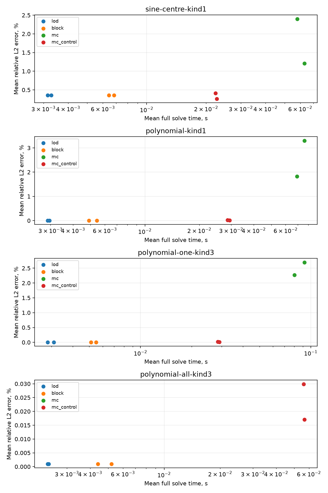

# Пилот четырёх методов в физическом времени

На сетке n=8 подтверждены 42 из 48 целей 1/5/10%. Из 175 полных попыток
150 дошли до T=0,004, 25 остановились по лимиту итераций Пикара. ЛОМ оказался
быстрее обоих MC-вариантов во всех подтверждённых сравнениях. Все попытки
и проигрыши сохранены. Это первая короткая временная серия #31.

## Постановка и воспроизведение

Измерена чистая версия `d9eecce` на основе опубликованного main `77c69d8`
после #46. Время измерений 26 ноября 2026 года, 00:24:50–00:25:07 МСК.
Исходники, commit и чистота дерева совпали до и после серии. С исполнителем А
заранее согласовано окно без его тестов и расчётов. Методы запускались
последовательно в отдельных процессах, потоки BLAS/Numba ограничены одним.
Порядок фиксирован, рандомизация порядка отсутствует, выбросы времени сохранены.

Неявный Эйлер, dt=0,002, два слоя до T=0,004, α=0,5. На сетке n=8
используются синус в центре (0,5; 0,5; 0,5) и полином в точке (0,25; 0,5; 0,75).
Для полинома проверены все грани 1 рода, x0 3 рода и все грани 3 рода, β=1.
Контрольное поле имеет coarse_n=4, H/h=2. Формулы задачи заданы в
[общем контракте](../../../docs/heat3d-contract.md).

R=5 для каждой предварительной и финальной серии, seed=31026. Запас на
предварительной серии 0,8. Кандидаты прогонок 10⁻³ и 10⁻⁶, MC 256 и 1024 пути
на свободный узел за оценку. Допуски MC по нелинейной невязке и изменению
поля равны 0,2 и 0,1. На слой разрешено восемь итераций Пикара. Полные
лимиты и порядок записаны в [плане](plan.json). Все методы оплачивают вычисление
полного поля, независимые проверки MC и каждый физический слой.

Метрика равна 100 × среднее по повторам |u(T)−u*(T)|/|u*(T)| в выбранной точке.
Эталон аналитический. Сеточная диагностика Ньютона для этих конфигураций
отдельно в этом пилоте не выполнялась. После выбора бюджета новая независимая
финальная серия проверяет цель, её результат завершает подбор.

```sh
python -m benchmarks.heat3d_pilot --plan benchmarks/heat3d-pilot.json --out runs/heat3d-pilot-check
```

[Описание сценария и границы таймеров](../../heat3d-pilot.md).
[Версия, контрольные суммы и порядок](manifest.json).

## Подтверждённые цели и время

Одна финальная серия может подтвердить несколько целей. Ниже она показана
один раз, с перечнем целей. Время — среднее пяти полных финальных запусков.
Стандартное отклонение описывает разброс времени этих пяти запусков.
Все отдельные строки 1/5/10% сохранены в [targets.csv](targets.csv).

| Случай | Метод | Цели, % | Бюджет | Ошибка, % | Время ± SD, мс |
|---|---|---|---:|---:|---:|
| Синус, центр, 1 род | ЛОМ | 1, 5, 10 | 0.001 | 0.35793 | 3.147 ± 0.076 |
| Синус, центр, 1 род | Матричная прогонка | 1, 5, 10 | 0.001 | 0.35793 | 6.434 ± 0.210 |
| Синус, центр, 1 род | Обычный MC | 5, 10 | 1024 | 2.39997 | 57.882 ± 6.259 |
| Синус, центр, 1 род | Грубая сетка + MC | 1, 5, 10 | 256 | 0.26026 | 22.658 ± 0.722 |
| Полином, 1 род | ЛОМ | 1, 5, 10 | 0.001 | 0.00226 | 2.890 ± 0.106 |
| Полином, 1 род | Матричная прогонка | 1, 5, 10 | 0.001 | 0.00226 | 4.893 ± 0.082 |
| Полином, 1 род | Обычный MC | 5, 10 | 1024 | 3.30005 | 76.249 ± 4.236 |
| Полином, 1 род | Грубая сетка + MC | 1, 5, 10 | 256 | 0.01826 | 28.621 ± 0.485 |
| Полином, x0 3 рода | ЛОМ | 1, 5, 10 | 0.001 | 0.00303 | 2.844 ± 0.251 |
| Полином, x0 3 рода | Матричная прогонка | 1, 5, 10 | 0.001 | 0.00303 | 5.120 ± 0.143 |
| Полином, x0 3 рода | Обычный MC | 5, 10 | 1024 | 2.27419 | 80.069 ± 1.462 |
| Полином, x0 3 рода | Грубая сетка + MC | 1, 5, 10 | 256 | 0.01756 | 28.419 ± 0.243 |
| Полином, все 3 рода | ЛОМ | 1, 5, 10 | 0.001 | 0.00097 | 2.361 ± 0.051 |
| Полином, все 3 рода | Матричная прогонка | 1, 5, 10 | 0.001 | 0.00097 | 4.397 ± 0.276 |
| Полином, все 3 рода | Обычный MC | Нет | 256 / 1024 | — | — |
| Полином, все 3 рода | Грубая сетка + MC | 1, 5, 10 | 256 | 0.01700 | 56.726 ± 1.297 |

## Неподтверждённые цели

Для обычного MC цель 1% не прошла предварительный запас 0,8% при всех гранях
1 рода и при одной грани 3 рода. Ошибки предварительной серии N=1024 равны
1,2063% для синуса, 1,8197% для полинома с границами 1 рода и 2,6969% для
полинома с x0 3 рода. Финальные серии этого бюджета подтвердили цели 5% и 10%.

При N=256 все пять запусков обычного MC в каждом из четырёх случаев
исчерпали восемь итераций первого слоя. При всех гранях 3 рода то же
произошло и во всех пяти запусках N=1024. Эта пара бюджетов израсходовала
2,399 с времени решателя и не дала полной истории. Средняя ошибка этой
неполной серии и время достижения её целей отсутствуют. Все причины и
достигнутые моменты доступны в [trials.csv](trials.csv).

## Подготовка, подбор и память

Подготовка в таблице — среднее финальной серии, включая сборки операторов
и грубую подготовку. Она уже входит во время решателя. Затраты подбора
и финальных серий суммируются по всем попыткам. RSS — максимум отдельного
процесса исследования до экспорта, включая библиотеки, JIT и все повторы.
Оценки рабочих буферов и отсутствие измерений RSS отдельных запусков сохранены
в исходном API. [Затраты каждой пары задача/метод](costs.csv).

| Случай | Метод | Подготовка финального запуска, мс | Подбор, с | Финальная серия, с | Пик RSS процесса, МиБ |
|---|---|---:|---:|---:|---:|
| Синус, центр, 1 род | ЛОМ | 2.286 | 0.0164 | 0.0157 | 166.5 |
| Синус, центр, 1 род | Матричная прогонка | 4.479 | 0.0341 | 0.0322 | 116.6 |
| Синус, центр, 1 род | Обычный MC | 3.175 | 0.4770 | 0.2894 | 173.6 |
| Синус, центр, 1 род | Грубая сетка + MC | 6.895 | 0.1115 | 0.1133 | 148.7 |
| Полином, 1 род | ЛОМ | 2.150 | 0.0148 | 0.0145 | 147.8 |
| Полином, 1 род | Матричная прогонка | 3.562 | 0.0271 | 0.0245 | 116.6 |
| Полином, 1 род | Обычный MC | 3.761 | 0.5635 | 0.3812 | 148.3 |
| Полином, 1 род | Грубая сетка + MC | 8.103 | 0.1472 | 0.1431 | 149.9 |
| Полином, x0 3 рода | ЛОМ | 2.093 | 0.0155 | 0.0142 | 148.4 |
| Полином, x0 3 рода | Матричная прогонка | 3.719 | 0.0274 | 0.0256 | 118.2 |
| Полином, x0 3 рода | Обычный MC | 3.283 | 0.7218 | 0.4003 | 148.5 |
| Полином, x0 3 рода | Грубая сетка + MC | 6.973 | 0.1451 | 0.1421 | 148.4 |
| Полином, все 3 рода | ЛОМ | 1.457 | 0.0120 | 0.0118 | 148.6 |
| Полином, все 3 рода | Матричная прогонка | 2.902 | 0.0261 | 0.0220 | 118.0 |
| Полином, все 3 рода | Обычный MC | — | 2.3990 | 0.0000 | 148.3 |
| Полином, все 3 рода | Грубая сетка + MC | 6.363 | 0.2812 | 0.2836 | 148.8 |

## Влияние границ и пределы выводов

Для полинома при подтверждённой цели 5% отношение времени ЛОМ к обычному MC
равно 0,038 при всех гранях 1 рода и 0,036 при x0 3 рода. Сам MC при
добавлении одной грани 3 рода замедлился в 1,05 раза. Для всех граней 3 рода
отношение времени достижения цели недоступно из-за незавершённых серий MC.

Вариант с грубой сеткой подтвердил все цели при N=256. Его время для полинома
выросло с 28,62 до 56,73 мс при замене всех границ на условия 3 рода.
Число свободных узлов выросло с 343 до 729. Вместе с граничными весами
изменился объём оплачиваемой работы. Отдельный эффект обработки границ
этим сравнением не выделен.

Выбранные бюджеты обычного MC и поправки различаются. Вывод о снижении
дисперсии при одинаковом N требует отдельного фиксированного сравнения.
Сетка, два слоя времени и R=5 ограничивают переносимость результатов.
Пилот показывает стоимость и отказы на заранее заданных конфигурациях.



На графике показаны все завершённые предварительные и финальные серии.
Неполные серии описаны таблицами и причинами выше.

Следующий этап после слияния группировки — зафиксировать общую версию шести
методов, проверить несколько размеров групп при одинаковом N, затем
расширить сетки, историю, H/h и область запроса по оценке ресурсов.
При этом нужны отдельные сравнения совпадающих целей и фиксированных бюджетов.
Issue #31 остаётся открытым для общей серии и итогового отчёта.
