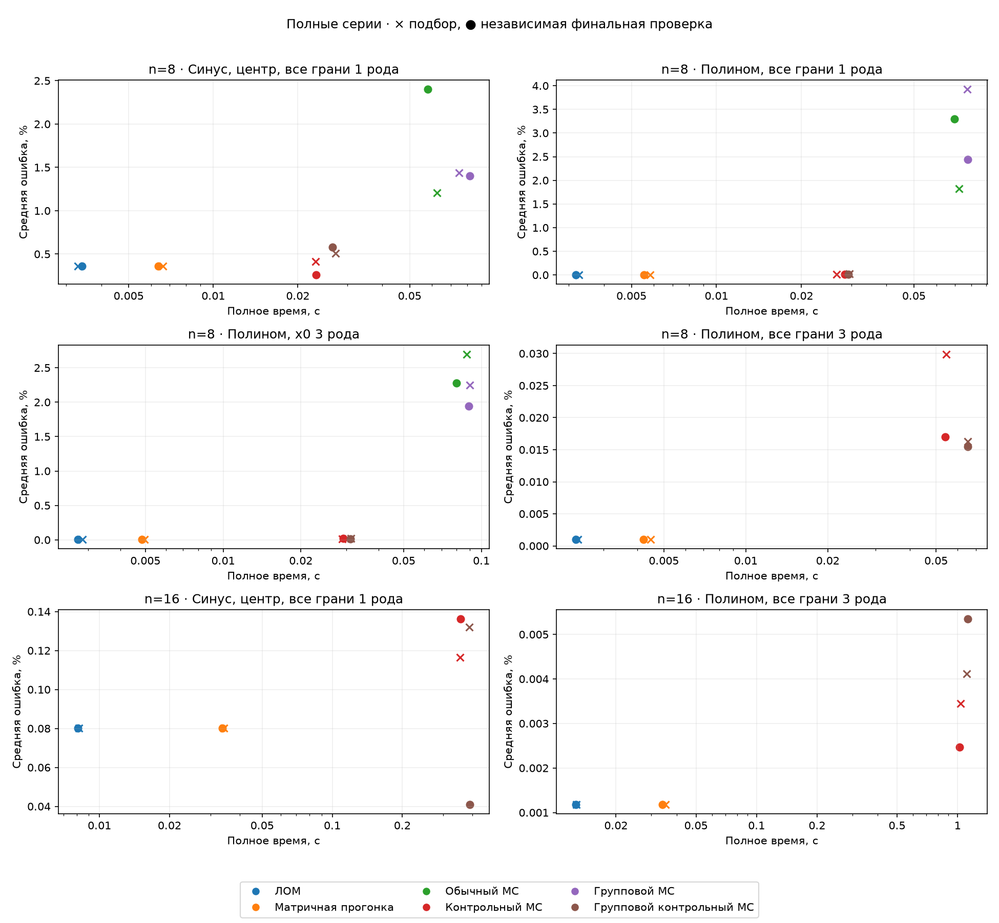
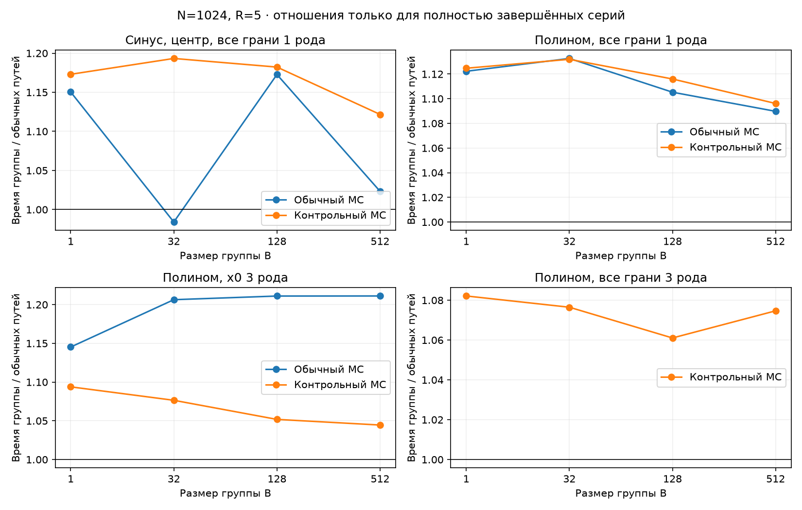

# Шесть методов нелинейной 3D-теплопроводности

В основной серии подтверждены **84 из 108 целей 1/5/10%**. ЛОМ дал наименьшее
среднее время достижения каждой подтверждённой цели на обеих сетках.
Контрольное приближение позволило MC завершить все исследованные случаи,
включая полином со всеми гранями 3 рода на n=16. Для группировки устойчивого
выигрыша в этих измерениях не получено.

Всего сохранены **590 попыток**. До T дошли 475, ещё 105 исчерпали итерации
Пикара, четыре — предел переходов, шесть — время. Все отказы входят в затраты.
Основная серия содержит 390 попыток, отдельная серия размеров групп — 200.
[Основная таблица](comparison.md), [CSV всех целей](comparison.csv),
[таблица размеров групп](groups.md), [CSV размеров групп](groups.csv).

## Версия и план

Измерения проведены 26 ноября 2026 года на одном компьютере в согласованное
окно после профиля исполнителя А. Процессы последовательные, BLAS/Numba
используют один поток. Порядок методов фиксирован, выбросы времени сохранены.
Контрольные суммы исходников и чистота дерева проверены до и после каждой серии.

- n=8 и размеры групп измерены на `aefae24`, с планами из того же коммита.
  Ядра соответствуют main `131dda6`, содержащему все шесть методов.
- План n=16 зафиксирован после оценки малых серий в `76fe6a2`. Этот же
  коммит измерен. Между сериями менялись план и его описание.
- Во время измерений в main слились отчёты #48 и #49. После замеров
  интегрирован main `b81c243`. Различий в `pdelab` относительно `131dda6` нет.
- [Первый пилот #48](../heat3d-pilot/README.md) сохранён с версией `d9eecce`.
  Четыре повторно измеренных базовых метода на n=8 воспроизвели его ошибки,
  статусы и счётчики. Новое время измерено отдельно.

Неявный Эйлер, α=0,5, dt=0,002, два слоя до T=0,004. Синус вычисляется
в центре куба, полином — в точке (0,25; 0,5; 0,75). На n=8 сохранены
четыре сценария пилота. Для полинома сравниваются все грани 1 рода,
x0 3 рода и все грани 3 рода при β=1. На n=16 выбраны синус с условиями
1 рода и полином со всеми гранями 3 рода. H/h=2 на обеих сетках.
[Формулы и общий контракт](../../../docs/heat3d-contract.md).

До расширения малые серии дали максимум 0,493 с на попытку и суммарно
42,51 с времени решателей. На n=16 выбраны два случая с увеличенными
в восемь раз пределами путей и переходов. Предел времени 5 с, восемь
итераций Пикара на слой и 256 МиБ оценки буферов сохранены.
[Зафиксированные решения и команды](../../heat3d-six-methods.md).

## Метрика и стоимость

Общий протокол на предварительных сериях R=5 выбирает первый бюджет
с ошибкой не более 0,8 цели. Затем новая независимая серия R=5 проверяет
цель. После неё выбор бюджета завершён. Ошибка равна среднему по полным
запускам относительной L2-ошибки в Q. Здесь Q — одна точка, поэтому метрика
равна `100 × mean(|u(T)−u*(T)| / |u*(T)|)`. Эталон аналитический.
Ньютон в этой серии отдельно не запускался.

Бюджеты MC — 256 и 1024 пути на свободный узел за оценку полного поля.
Допуски MC по нелинейной невязке и изменению поля равны 0,2 и 0,1.
Для прогонок проверяются 10⁻³ и 10⁻⁶. Основная серия использует
**B=128, выбранный до замеров**, для обоих групповых вариантов.
Невязка и изменение поля контролируют приёмку слоя. Неполная серия
сохраняет причины отказов и результаты отдельных завершённых попыток.
Её средняя ошибка и время достижения цели отсутствуют.

Время решателя включает подготовку, грубое поле, все слои, итерации и
независимые проверки. Подготовка уже входит в полное время. Затраты одной
серии могут повторяться в строках разных целей. Для суммирования используйте
уникальные серии или `costs.csv` стадии. RSS измерен на процесс исследования
до экспорта, включая библиотеки, JIT и все повторы. Он назван отдельно от
оценки буферов. JIT и эталоны исключены из времени решателя.
Мягкий предел времени допускает завершение начатой оценки, самая долгая
попытка на n=16 заняла 5,763 с.

## Основные результаты

Ниже среднее время подтверждённой цели 5%, в миллисекундах. Прогонки и оба
контрольных варианта также подтвердили 1% и 10% во всех случаях. Обычный и
групповой MC на n=8 подтвердили 5% и 10% в первых трёх случаях, запас для
1% не достигнут. Прочерк означает незавершённую предварительную серию.
Полные данные с ошибкой, памятью, путями и отказами находятся в основной таблице.

| Сетка и случай | ЛОМ | Матричная | MC | Контрольный MC | Групповой MC | Групповой контрольный MC |
|---|---:|---:|---:|---:|---:|---:|
| n=8, синус, 1 род | 3,41 | 6,39 | 57,91 | 23,21 | 81,78 | 26,62 |
| n=8, полином, 1 род | 3,18 | 5,54 | 69,67 | 28,50 | 77,64 | 29,33 |
| n=8, полином, x0 3 рода | 2,74 | 4,84 | 80,27 | 29,24 | 89,54 | 31,06 |
| n=8, полином, все 3 рода | 2,38 | 4,20 | — | 54,05 | — | 65,43 |
| n=16, синус, 1 род | 8,07 | 33,66 | — | 355,42 | — | 389,36 |
| n=16, полином, все 3 рода | 12,65 | 34,04 | — | 1024,21 | — | 1124,99 |

На n=8 обычный и групповой MC с N=256 исчерпали итерации во всех
предварительных повторах. При всех гранях 3 рода это произошло и с N=1024.
На n=16 при синусе оба метода также остановились по лимиту Пикара.
В полиномиальном случае к нему добавились предел переходов и время.
Все отказы произошли на первом слое, затраты сохранены.

Для полинома на n=8 при цели 5% отношение времени ЛОМ к обычному MC равно
0,0457 для границ 1 рода и 0,0341 при x0 3 рода. Время самого MC выросло
в 1,15 раза. При всех гранях 3 рода отношение времени достижения цели
недоступно. Число свободных узлов меняется вместе с граничными условиями.
Отдельная стоимость границ исследована в [профиле #32](../../../docs/heat3d-boundary-costs.md).



График включает полные предварительные и финальные серии. Неполные серии
представлены таблицей со статусом и причиной.

## Размеры групп при одинаковом N

Отдельно заранее зафиксированы N=1024, B=1,32,128,512, R=5 и seed=31027.
Проверены оба MC-семейства во всех четырёх случаях n=8. Финальная серия
основного исследования не использовалась для выбора B. Для B=1 совпали
значения, остановка и счётчики обычного и группового вариантов во всех
восьми парах сценарий/семейство.

Из 28 сравнений с соответствующими обычными путями, где завершены все
повторы, в 27 среднее время группы больше. Единственное меньшее среднее —
обычный групповой MC с B=32 на синусе, 64,42 против 65,47 мс. При этом начато
7 024 640 против 8 078 336 путей на пять историй. Изменение порядка случайных
выборов повлияло на остановку Пикара и объём работы. Различие полного времени
не устанавливает ускорения обработки пути.

При всех гранях 3 рода обычное MC-семейство не завершило ни одного повтора.
Для контрольного семейства завершились все варианты, каждый размер группы
дал большее среднее время. Различия ошибок при R=5 описывают конкретную
выборку. Уменьшение дисперсии от группировки этими данными не установлено.



## Где методы полезны по этим данным

- **ЛОМ** — самый быстрый из проверенных способов достижения всех трёх целей
  для двухслойной истории на n=8 и n=16. Оценка буферов на n=16 около 1,50 МиБ.
- **Матричная прогонка** — даёт практически те же ошибки, что ЛОМ, и позволяет
  сопоставить два способа решения линейной системы. Время здесь больше,
  оценка буферов на n=16 около 25,38 МиБ.
- **Обычный MC** — воспроизводимая база для оценки контрольного поля и
  группировки. На n=8 подтвердил 5% и 10% в трёх случаях. На n=16
  заданных бюджетов и ограничений оказалось недостаточно.
- **Контрольный MC** — наиболее успешный из MC-вариантов по сочетанию
  подтверждённых целей и времени. Все цели достигнуты при N=256.
  На полиноме со всеми гранями 3 рода при n=16 он получил 0,00247% ошибки
  за 1,024 с, включая примерно 10,59 мс подготовки. Его полное время
  на этих задачах превышает время прогонок.
- **Групповой MC** — подтвердил те же наборы целей, что обычный MC, с большим
  средним временем при B=128. Практического преимущества здесь не обнаружено.
- **Групповой контрольный MC** — завершил все случаи и подтвердил все цели.
  При B=128 он медленнее контрольного MC во всех шести конфигурациях.

Каждый запрос требует полных полей для проводимости и следующего слоя.
Измерение одной точки включает эту стоимость. Выводы относятся к изготовленным
задачам, двум физическим слоям, H/h=2 и заданным бюджетам. Пять повторов
и фиксированный порядок методов ограничивают статистическую силу сравнения.
Другие H/h, длинная история, срезы/поля, n=32 и расширенная модель #30 здесь
не исследованы.

## Данные и воспроизведение

| Стадия | Заданий / попыток | Достигнутых целей | Манифест | Все попытки | Сводка |
|---|---:|---:|---|---|---|
| n=8, шесть методов | 24 / 270 | 60 / 72 | [Версия и план](n8/manifest.json) | [CSV](n8/trials.csv) | [Цели](n8/targets.csv) |
| n=8, размеры групп | 40 / 200 | Фиксированный N | [Версия и план](groups/manifest.json) | [CSV](groups/trials.csv) | [Сводка](groups/summary.csv) |
| n=16, два случая | 12 / 120 | 24 / 36 | [Версия и план](n16/manifest.json) | [CSV](n16/trials.csv) | [Цели](n16/targets.csv) |

Каждому заданию соответствует JSON рядом с манифестом. Планы содержат все
параметры. Команды замеров требуют свободного окна и новых выходных каталогов.

```sh
python -m benchmarks.heat3d_pilot --plan benchmarks/heat3d-six-n8.json --out runs/heat3d-six-n8-check
python -m benchmarks.heat3d_pilot --plan benchmarks/heat3d-groups-n8.json --out runs/heat3d-groups-n8-check
python -m benchmarks.heat3d_pilot --plan benchmarks/heat3d-six-n16.json --out runs/heat3d-six-n16-check
python -m benchmarks.heat3d_six_report --root benchmarks/results/heat3d-six-methods
```

Последняя команда пересобирает таблицы и графики по сохранённым данным.
Для воспроизведения первоначальных замеров используются указанные выше
коммиты. Исходные JSON стадий остаются доступными для независимой проверки.
