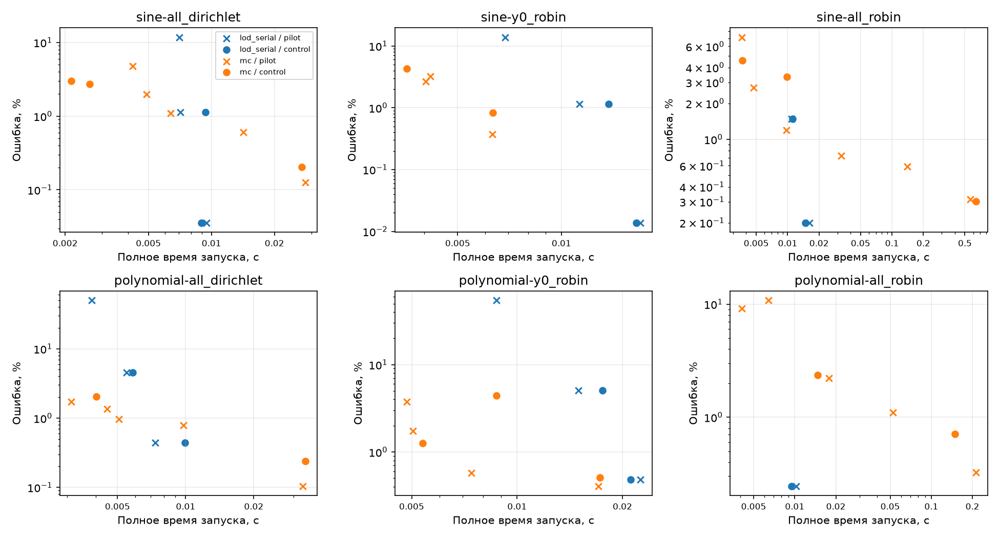

# Ранние результаты #27: стационарные 3D-границы

n=16, R=5, Q=[[0.5, 0.5, 0.5]], seed=20261125. Две функции #24 при t=0, k=1, beta=1. Ошибка — среднее относительных L2-ошибок полных запусков. Это стационарный опыт; перенос на нелинейную временную задачу ещё не выполнен.

## Цель 1%

Время включает новую подготовку данных и полный решатель, исключает прогрев/JIT и внешнюю оценку ошибки. Память — оценка рабочих буферов; измеренного RSS нет. Время подбора сохранено отдельно в CSV/JSON.

| Функция | Границы | Метод | Ошибка, % | Время ± s, мс | Бюджет | Пути / итерации за повтор | Буферы, МиБ | Статус |
|---|---|---|---:|---:|---:|---:|---:|---|
| sine | Все 1 рода | lod_serial | 0.035 | 8.97 ± 2.20 | 0.0001 | 67 | 2.40 | confirmed |
| sine | Все 1 рода | mc | 0.203 | 27.04 ± 1.46 | 16384 | 16384 | 2.52 | confirmed |
| sine | y0 — 3 рода | lod_serial | 0.014 | 16.49 ± 4.20 | 0.0001 | 78 | 2.40 | confirmed |
| sine | y0 — 3 рода | mc | 0.838 | 6.31 ± 0.74 | 1024 | 1024 | 2.41 | confirmed |
| sine | Все 3 рода | lod_serial | 0.199 | 14.82 ± 1.30 | 0.001 | 39 | 2.40 | confirmed |
| sine | Все 3 рода | mc | 0.302 | 635.80 ± 75.26 | 65536 | 65536 | 2.90 | confirmed |
| polynomial | Все 1 рода | lod_serial | 0.444 | 9.94 ± 2.52 | 0.0001 | 58 | 2.40 | confirmed |
| polynomial | Все 1 рода | mc | 0.239 | 33.76 ± 2.52 | 16384 | 16384 | 2.52 | confirmed |
| polynomial | y0 — 3 рода | lod_serial | 0.481 | 21.07 ± 1.15 | 0.0001 | 67 | 2.40 | confirmed |
| polynomial | y0 — 3 рода | mc | 0.510 | 17.23 ± 1.08 | 4096 | 4096 | 2.43 | confirmed |
| polynomial | Все 3 рода | lod_serial | 0.245 | 9.49 ± 0.98 | 0.01 | 21 | 2.40 | confirmed |
| polynomial | Все 3 рода | mc | 0.712 | 148.48 ± 21.31 | 16384 | 16384 | 2.52 | confirmed |

## Два разных отношения времени

ЛОМ/MC > 1 означает меньшую измеренную цену MC для одинаковой подтверждённой цели. MC/MC с 1 родом показывает изменение цены самого MC при смене границ. В этот показатель входят и различия выбранных бюджетов, и время одной траектории; он не изолирует цену отражения. Цели 5/10% и все попытки находятся в CSV/JSON.

| Функция | Границы | ЛОМ / MC при 1% | MC / MC с 1 родом при 1% |
|---|---|---:|---:|
| sine | Все 1 рода | 0.332 | 1.000 |
| sine | y0 — 3 рода | 2.612 | 0.234 |
| sine | Все 3 рода | 0.023 | 23.517 |
| polynomial | Все 1 рода | 0.294 | 1.000 |
| polynomial | y0 — 3 рода | 1.223 | 0.510 |
| polynomial | Все 3 рода | 0.064 | 4.398 |



## Ограничения

R=5 — пилот без статистической гарантии. Одна сетка и одна внутренняя точка; n=32 и нецентральная точка ещё не измерены. Нет вывода об универсальном выигрыше. Все выбранные здесь контрольные серии прошли, но неподходящие бюджеты пилота также сохранены. Пределы времени и пути мягкие/явные согласно protocol.json. Отказы и неполные серии проверены отдельными тестами.

В файлах protocol.json/source.zip сохранены commit, признак dirty, хеши и исходники исполнявшегося кода. Незакоммиченный runner не объявлен частью main. Отчёт построен из сохранённых наблюдений отдельно, без повторного подбора.

## Воспроизведение

```sh
python -m pdelab.boundary_audit3d --n 16 --repeats 5 --seed 20261125 --seconds 120.0 --functions sine polynomial --point center --out runs/boundary-audit-reproduction
python -m pdelab.boundary_audit_report runs/boundary-audit-reproduction
```
